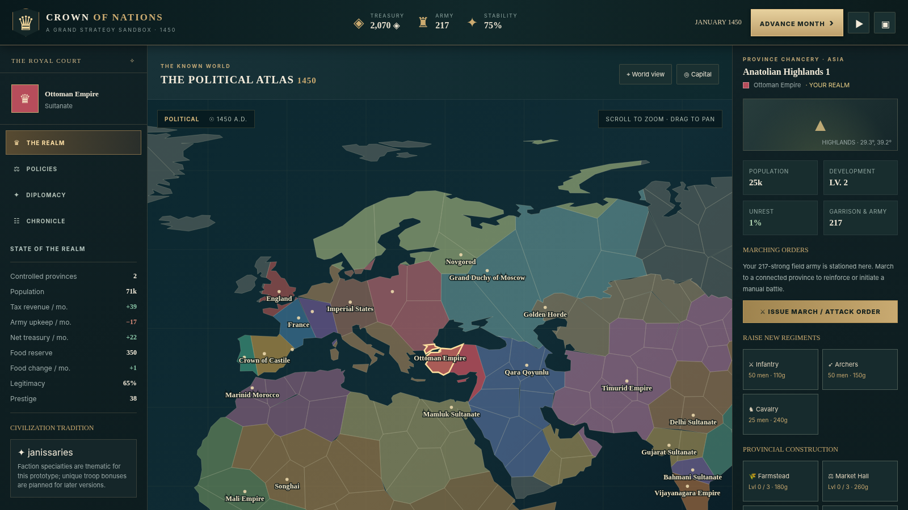

# Crown of Nations — 1450

**A playable, zero-dependency browser grand-strategy prototype** with a worldwide 1450-themed campaign, customizable royal policies, territorial conquest, recruitment, construction, diplomacy, economic simulation, AI rivals, and controllable real-time 3D tactical battles.



> **State of development: vertical-slice prototype, NOT a complete historical grand-strategy game.** Historical polities and starting dates are inspired by the real year 1450, but the 299 province polygons are generated test geometry and **do not represent verified historical borders**. The 44 factions are representative rather than comprehensive; initial economy and military numbers are fictional balance data. Manual battles have geometric placeholder soldiers, not final production art. Review [known limitations](docs/KNOWN_LIMITATIONS.md).

## Play locally — no dependency installation

1. Download/extract the project ZIP (or clone the Git repository). On a Mac, you can double-click `START_GAME_MAC.command` (if Python 3 is installed). Windows users can launch `START_GAME_WINDOWS.bat`.
2. Open a terminal in the project directory.
3. Run `python3 -m http.server 8080` (Mac/Linux), or `py -m http.server 8080` on Windows.
4. Visit **http://localhost:8080** in Chrome, Edge, Firefox, or Safari.
5. Choose a historical polity and click **Begin Your Reign**.

The game runs locally after the files load; it does not need a game server, npm packages, cloud accounts, or a paid API. Google Fonts may load if online; system fonts are the fallback. Local saves are tied to the browser and origin (`localhost:8080`).

## What works today

- 299 generated map provinces across **Europe, Asia, Africa, North America, South America, and Oceania**. Pan/zoom/inspect on a bundled coastlines map.
- 44 **playable named polities** with thematic faction identities and starting geographic positions.
- Monthly calendar progression, treasury, revenue, upkeep, food, unrest, stability, legitimacy, prestige, and population growth.
- Three classes of **royal decrees**: taxation, recruitment laws, and tolerance.
- Four **province buildings**: farms, markets, barracks, and forts; each upgrades three times.
- Recruitment of infantry, archers, and cavalry, with budget and unrest consequences.
- Adjacent land movement, manual battles against rival provinces, capture, casualties, and territory transfer to campaign.
- Real-time battlefield with 12 formations, soldier formations (infantry, archers, cavalry), rally banners, ranged attacks, morale, routs, basic enemy behavior, movement orders, and win/lose outcomes.
- Native instanced **WebGL2 renderer**, with an alternate Canvas 2D renderer projecting 3D cuboids when WebGL2 is unavailable. Does not rely on external 3D engines or CDNs.
- Rival AI invests, recruits, and fights limited autonomous border conflicts. Not full diplomatic/strategic AI.
- Diplomatic gifts, improved relations, alliance proposals, insults, an event chronicle, manual and automatic time progression.
- Browser localStorage save/continue; deterministic campaign simulation core.

## Controls

| Campaign | Battlefield |
| --- | --- |
| Drag map to pan; scroll to zoom | Left-click regiment or press `1–6` |
| Click a province to inspect | Right-click terrain to move selected regiment |
| In an owned province, choose **Issue March / Attack Order** then click an adjacent destination | `WASD` pan, `Q/E` rotate, mouse wheel zoom |
| **Advance Month** steps the campaign; `▶` auto-progresses | `Space` pause, Retreat button concedes |
| Save button stores the campaign locally | After battle, **Return to Campaign** applies casualties and territorial result |

## Project structure

```text
index.html                     Main application shell and accessible controls
styles.css                     Dark parchment-themed strategy UI
src/main.js                    Screens, event handling, game orchestration
src/map.js                     Interactive Canvas2D cartographic renderer
src/simulation.js              Deterministic economic, political & war simulation
src/battle.js                  WebGL2 / perspective 2D tactical renderer and AI
data/world.json                Generated provinces, connections, 44 factions
assets/naturalearth/           Bundled Natural Earth public-domain shapefile
assets/favicon.svg             Original icon
scripts/build_world.py         Rebuild province layout from bundled data
scripts/render_smoke_test.py   Optional Linux Playwright UI integration test
tests/simulation.test.mjs      7 Node.js simulation regression tests
docs/GAME_BLUEPRINT.md         Architecture and extended design specification
docs/ASSET_MANIFEST.md         Verified CC0/public-domain assets and import priorities
docs/IMPLEMENTATION_PLAN.md    Concrete next implementation milestones
docs/KNOWN_LIMITATIONS.md      What is incomplete and what was actually tested
```

## Verification

```bash
node --test tests/*.test.mjs
node --check src/main.js
node --check src/simulation.js
node --check src/map.js
node --check src/battle.js
```

The Python-based visual test in `scripts/render_smoke_test.py` is a development-only harness requiring Python Playwright and a local Chromium executable; its hardcoded Linux path must be adapted on Mac/Windows. The actual game has **no Python or npm dependencies at runtime**, except a tiny static file server to serve ES modules and JSON. Previews included in `docs/` were taken from this integration harness.

## Sources and licenses

- **Natural Earth** geography is [public domain](https://www.naturalearthdata.com/about/terms-of-use/); included shapefile is used for coastlines/landmass, not modern national borders in gameplay. Generated political test cells are original procedural geometry.
- Game implementation (excluding third-party assets) is released under the MIT license (see `LICENSE`).
- **Other researched CC0 asset packs are listed but NOT shipped**. No unverified art, sound, fonts, or historical border data have been silently copied into the repository. See [Asset Manifest](docs/ASSET_MANIFEST.md).

## Publishing to a *new* GitHub repository

The package can be used as a local Git repository. If you're adding the downloaded ZIP to an empty repository created on GitHub, from its extracted directory run:

```bash
git remote add origin https://github.com/YOUR_USERNAME/crown-of-nations.git
git push -u origin main
```

Create an empty repository in GitHub first, **without** initializing README/license, and replace `YOUR_USERNAME` with your own account. Creating a remote repository requires repository-creation permissions. The game is not hosted or automatically deployed just because the files exist locally.

## Credits

Design and implementation: AI-assisted prototype built for the requester. Map base data: Natural Earth (public domain). No assets from Crusader Kings, Europa Universalis or Total War are distributed with this project; their names describe genre references only.

## Milestone 01 — Real GLB battlefield scenery

The native WebGL2 battle can load CC0 Kenney castle GLB models and existing historical Indian source models. Infantry formations now use additional low-poly geometry types. Existing campaign, diplomacy, economy and battle-result logic are preserved. See [milestone verification](docs/MILESTONE_01_BATTLE_3D.md).

The downloadable Milestone 01 package includes a small CC0 Kenney subset. When using this GitHub branch directly, import your copy of the official [Kenney Castle Kit](https://kenney.nl/assets/castle-kit) using:

```bash
python3 scripts/import_kenney_castle.py /path/to/kenney_castle-kit.zip
```

The source branch's stone wall GLB is a fallback when the local Kenney wall is absent. The world map and battle graphics are still work in progress; native WebGL2 visual quality has not yet been GPU-tested in this environment.
