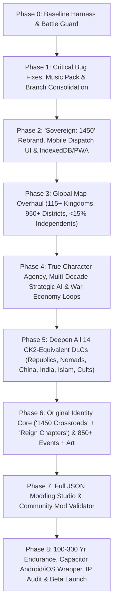

# **SOVEREIGN: 1450** — Master Engineering, Original Identity & Mobile Launch Plan


> **Target Baseline Audited:** Repository `akshat92008/crusaderkings` at commit **`ef5b815`** (`95` source files / `35,737` lines in `src/`, `107` test files in `tests/`, `714 / 714` automated tests passing, `724` playable districts, `57` faction keys / `56` named realms + `406` independent districts, `133` source features in `data/historical-polities-1450.json`, `536` optimized art assets).  
> **Execution Owner:** Designed as an unambiguous, step-by-step specification for **Claude Code** to execute cleanly with strict verification gates at every phase.

---

## Non-Negotiable Engineering Guardrails (Must Follow Every Phase)

> [!CAUTION]
> **DO NOT MODIFY BATTLE CODE OR BATTLE ASSETS.** The user is working on Battle separately on another track. Leave all battle files **100% untouched** across every phase below.

1. **Zero Edits Allowed in Battle Files:**
   - Do **not** edit: `src/battle.js`, `src/battle-lifecycle.js`, `src/battle-presentation.js`, `src/battlefield-art.js`, `src/battlefield-layout.js`, `src/border-battle.js`, `src/banner-renderer.js`, `src/field-atmosphere.js`, `src/field-audio.js`, `src/field-forces.js`, `src/field-scenery.js`, `src/field-tactics.js`, `src/field-visuals.js`, `src/simple-card-battle.js`, `src/three-battle-scene.js`, `src/three-battle.bundle.js`, `assets/battle/**`, `assets/characters_3d/**`, `scripts/build_3d_battle.mjs`, `scripts/battle_browser_smoke.py`.
   - Any integration between campaign politics/doctrines/supply and tactical battles MUST only pass read-only input metadata through existing call boundaries in `src/campaign-war.js` / `src/main.js`, never modifying battle internals.
   - Verify after **every** phase via:
     ```bash
     git diff --name-only | grep -E '^(src/(battle|field-|three-battle|border-battle|banner-renderer|simple-card-battle)|assets/(battle|characters_3d)|scripts/(build_3d_battle|battle_browser_smoke))'
     ```
     **Expected output:** empty (`exit 1`).
2. **Preserve Determinism & Save Compatibility:**
   - **Never** introduce `Math.random()`, `Date.now()`, or non-deterministic object key ordering into simulation state (`src/simulation.js` and all `src/*-systems.js`). Use existing deterministic hash helpers (`hashStr` in `src/ck2-deep-systems.js`).
   - Every schema addition must include defaults/rehydration in `restoreGame` + migration of older `crown-of-nations.save` saves into `sovereign-1450.save`.
3. **Never Bypass Failing Checks:** Every phase ends with concrete syntax, unit/integration, multi-browser Playwright, endurance, and package checks. Do **not** proceed to the next phase while any gate in the current phase fails.

---

## Plan Overview & Verification Flow



---

# PART I — SEPARATE STRATEGY PLAN: MAKING *SOVEREIGN: 1450* A 100% ORIGINAL GAME

> [!IMPORTANT]
> **Why players call a game a "cheap CK2 copy":** Not because it has dynasties, councils, traits, and vassals (those are genre staples like hex grids in *Civilization*), but when:
> 1. Menus, terms, and progression mimic a shrunk desktop Paradox UI without solving real pain points;
> 2. Every government plays almost identically under renamed buttons; and
> 3. The game lacks a signature hook, era identity, or UX flow that CK2 simply does not offer.

This dedicated Identity Track transforms **Crown of Nations** into **Sovereign: 1450**, an original **Mobile-First Global Grand Strategy + Commander Game** with its own creative soul.

## 1. Visual & Brand Identity Transformation (*Sovereign: 1450*)

- **Brand Palette & Art Direction:**
  - Anchor the entire visual system around the **Sovereign: 1450** crest (`media_1795669235222_c46c3adb.jpg`): **Obsidian Slate (`#0a1114`)**, **Imperial Crimson (`#6e181e`)**, **Antique Burnished Gold (`#ccab70` / `#f3d69b`)**, and **Cartographer Parchment (`#e6d7b4`)**.
  - Extract/produce clean web assets in `assets/branding/`:
    - `logo-hero.webp` / `logo-banner.webp` (Start screen, Play Store / App Store feature art, splash screen)
    - `crest-mark.svg` / `icon-192.png` / `icon-512.png` / `apple-touch-icon.png` (Globe-and-Crown silhouette with rampant crimson banners)
    - Loading / splash veil on boot so mobile players see polished key art instead of plain text while `world.json` densifies.
- **UI & Nomenclature De-Cloning Audit:**
  - Scrub leftover prototype wording ("Grand Strategy Sandbox", "Crown of Nations", raw debug-like labels) and adopt crisp, original **Sovereign: 1450** terminology across UI strings (keeping internal code identifiers non-breaking where tested, or migrating gracefully):
    - *Decisions* → **Royal Mandates**
    - *Monthly Turn Feed* → **The Crown Dispatch**
    - *De Jure / Title Tree* → **Crown Cartography & Claims**
    - *Way of Life Focus* → **Ruler Bearing / Discipline**
    - *Sandbox Tooltip / Ledger* → **Imperial Ledger** (collapsible for veterans; summary cards first for mobile)

## 2. Five Signature Original Pillars (What CK2 Does NOT Have)

### Pillar A: "The 1450 Crossroads" World Transformation Engine (`src/crossroads-eras.js`)
CK2 ends in 1453 and stays locked inside Afro-Eurasia. **Sovereign: 1450** spans the **entire world at the exact pivot of 1450–1620**:
- **5 Global Pivot Shifts** that fire organically as realms reach milestones (never hardcoded solely to Europe):
  1. **The Gunpowder Foundry:** Unlocks bronze siege artillery bonuses & reshapes castle/fort vulnerability across Ottomans, Ming, Europe, and India.
  2. **The Oceanic Horizon:** Long-range naval navigation opens transoceanic diplomacy, Spice Route monopolies, and coastal colonial/trade charters.
  3. **The Printing Press & Scholarly Stirring:** Accelerates institution spread, lowers tech/reform costs, and ignites heresy/reform debates faster.
  4. **Joint-Stock & Chartered Guilds:** Allows Merchant Republics & wealthy realms to charter long-distance trading companies and currency banks.
  5. **The First Contact Shock (Americas ↔ Old World):** Dynamic diplomacy, disease resistance shifts, trade winds, and alliance treaties when Atlantic/Pacific fleets meet American empires (Aztec, Inca, Tarascans, Haudenosaunee) as **equal playable actors**, not a scripted CK2 gimmick DLC.

### Pillar B: Mobile-First "Crown Dispatch" Loop (Built for 10-Minute Commute Sessions)
- Desktop CK2 requires clicking 10 tiny map modes and 8 nested tabs every turn. On mobile, that feels overwhelming and tedious.
- Build a first-class **Monthly Crown Dispatch** drawer/overlay (and slim quick-strip on desktop):
  - Automatically surfaces the **top 3–5 decisions/crises that actually matter this turn** as crisp tap-to-act **Dispatch Cards** (1-line stakes + Clear Icon + 2–3 choices + "Inspect Realm" link):
    1. *War & Border Alert* (Invasion incoming / War score swing / Allies calling)
    2. *Lineage & Court Crisis* (Heir unbetrothed / Claimant plotting / Jealous sibling demanding land)
    3. *Mandate & Narrative Event* (Context event / Focus progress / Petition)
    4. *Treasury & Trade Opportunity* (Shortage / Prosperity peak / Pact expiring)
  - Power users keep the **Full Sovereign Ledger** (all workspaces: Realm, Court, Diplomacy, Military, Society) one tap away.

### Pillar C: "Reign Chapters & Legacy Titles" (Micro-Campaign Satisfaction)
- When a new monarch inherits, the game dynamically assigns **1 Core Reign Mandate** + **2 Optional Ambitions** tailored to their traits, neighboring threats, and region (e.g., *Break the Boyar Pact*, *Secure the Hormuz/Malacca Strait*, *Unify the Three Crownlands*, *Survive a 7-Year Regency*, *Reform the Ancestral Faith*).
- Completing a Reign Chapter grants permanent **Chronicle Epithets** (*"the Shipbuilder"*, *"the Unbroken"*, *"Hammer of the Steppe"*), Dynasty Renown perks, and a shareable **End-of-Reign Portrait Card** ("King Mehmed II · Ruled 31 Years · 3 Wars Won · 1 Bloodline Forged").

### Pillar D: Asymmetric Civilizational Gameplay (True Replayability Across Every Continent)
- Playing **Venice**, **Golden Horde**, **Ming China**, **Vijayanagara**, **Aztec Triple Alliance**, and **France** must run on **genuinely distinct core mechanics** (detailed in Phase 5), not identical feudal taxes with different names.

### Pillar E: Two-Layer "Sovereign & Battle" Readiness Bridge (Without Touching Battle Code!)
- While your battle module stays isolated, make **campaign strategy clearly drive battle preparation**: before entering or auto-resolving any battle, show a concise **Campaign Readiness Card** summarizing how your *ruler martial trait, cultural doctrine, supply status, war exhaustion, terrain, and allied contingents* stack up. Winning/losing battles feeds cleanly back into *ruler prestige, commander rivalry/friendship, army morale reputation, prisoner ransom, and chronicle lore*.

## 3. Originality & Commercial IP Compliance Checklist

- Verify clean attribution and commercial license rights for every single runtime file in `assets/` (`assets/battle/characters/LICENSE.txt`, `assets/characters_3d/LICENSE-Polyfork.txt`, Cliopatria/Seshat CC BY 4.0 attribution, Natural Earth public domain, user-owned music/icons/UI art, Google Fonts Cinzel/Inter bundling for **100% offline mobile fonts**).
- Separate raw authoring packs (`assets/battle/kenney/` or any `source/` directories) completely from runtime distribution builds and add a dedicated `docs/COMMERCIAL_LICENSING.md` checklist.

---

# PART II — DETAILED EXECUTION ROADMAP WITH VERIFICATION GATES

---

## Phase 0 — QA Safety Harness, Multi-Browser Baseline & Battle-Exclusion Lock

### Objectives
Give Claude an ironclad automated safety net before touching a single line of gameplay code.

### Work Items
1. Add a package script `"verify:guard"` in [package.json](file:///Users/ashishsingh/Desktop/crusaderkings/package.json) that fails immediately if any forbidden battle file is modified relative to `HEAD` (when run during non-battle work) and checks `npm run check`.
2. Upgrade Playwright smoke runner helper (`scripts/_smoke_common.py`) to provide unified clean startup (`ThreadingHTTPServer` with `request_queue_size = 128`, free ephemeral port binding instead of hardcoded port clashes, and configurable engine flag `--browser chromium|firefox|webkit`).
3. Verify local `webkit` Playwright availability (or document installation command) so Safari/iPhone storage + rendering behavior is verified **locally** before every commit, not only in GitHub Actions.

### Verification Gate (Phase 0)
- `npm run verify:guard` exits `0`.
- `npm run check && npm test` exits `0` (`714 / 714` or higher).
- WebKit smoke run (`scripts/mobile_browser_smoke.py --browser webkit`) passes locally with `0` console errors and `0` unhandled page errors.

---

## Phase 1 — Critical Integration Fixes, Music Packaging & Branch Consolidation

### Confirmed Bugs to Fix Immediately
1. **Include Missing Soundtrack in Downloadable Builds:**
   - [scripts/package_playable.py](file:///Users/ashishsingh/Desktop/crusaderkings/scripts/package_playable.py) currently omits `assets/audio/music/` even though [src/soundtrack.js](file:///Users/ashishsingh/Desktop/crusaderkings/src/soundtrack.js) loads 11 MP3 tracks (`main_theme.mp3`, `main_theme_alt.mp3`, `campaign_europe.mp3`, `campaign_india.mp3`, `campaign_east_asia.mp3`, `warfare_1.mp3`, `warfare_2.mp3`, `intrigue_1.mp3`, `intrigue_2.mp3`, `succession_1.mp3`, `succession_2.mp3`).
   - Add all `assets/audio/music/*.mp3` files to `package_playable.py` (under `sovereign-1450/assets/audio/music/`) and assert every filename in `SOUNDTRACK` exists inside the generated ZIP inside [scripts/check_release_package.py](file:///Users/ashishsingh/Desktop/crusaderkings/scripts/check_release_package.py).
2. **Fix Mod Loader vs. Save Validator Year Conflict:**
   - [src/mod-loader.js](file:///Users/ashishsingh/Desktop/crusaderkings/src/mod-loader.js#L53) allows `pack.startYear` in `[400, 2000]`.
   - [src/portable-save.js](file:///Users/ashishsingh/Desktop/crusaderkings/src/portable-save.js#L6) throws `'Invalid campaign date.'` if `g.year < 1450`.
   - Fix `validatePortableSave` so valid years match `[400, 2500]` (matching custom scenarios while preventing NaN/negative/malformed years) and add a regression test importing & validating a year-1066 and year-867 modded save roundtrip.
3. **Reconcile Divergent Remote Branches (`origin/chatgpt/*`, `origin/codex/*`, `origin/content/*`, `origin/feature/*`):**
   - Run an automated inventory script comparing diffs of unmerged remote branches against `main` for strictly non-battle improvements (e.g., subholdings/baronies edge cases, court-travel events, institution narratives, character-intrigue edge cases, frontend prioritization).
   - **Rule:** Reconcile *clean missing features/fixes* selectively onto `main` — never blindly merge stale snapshots or overwrite newer work.
4. **Consolidate Overlapping Gameplay State:**
   - Audit overlapping data structures between `g.feudal` (baronies/holdings), `g.subholdings` (if present from legacy code), `g.deepSystems`, `g.dlcSystems`, `g.kingdom`, and `g.civic`. Define one canonical source of truth for:
     - Holding ownership & baronies (`src/feudal-systems.js` synced cleanly into `snapshot`/`restoreGame`)
     - Character health & stress (`src/living-systems.js` ↔ `src/ck2-deep-systems.js` ↔ `src/character-agency.js`)
     - Tax/trade/levy aggregate modifiers (`src/economy-systems.js` reading cleanly from `feudal`, `deepSystems`, `dlcSystems`, and `civic`).
5. **Update Outdated Docs:**
   - Refresh `README.md`, `docs/KNOWN_LIMITATIONS.md`, `docs/RELEASE_ACCEPTANCE.md`, and `docs/ASSET_MANIFEST.md` to reflect real counts and architecture (preserving honest known-limit disclosures).

### Verification Gate (Phase 1)
- `python3 scripts/package_playable.py && python3 scripts/check_release_package.py` passes **and explicitly verifies all 11 MP3 tracks** in `SOUNDTRACK`.
- New test in `tests/mod-loader.test.mjs` proves a mod pack with `startYear: 1066` passes `validatePortableSave(snapshot(g))` and reloads intact via `restoreGame(...)`.
- Battle-exclusion check passes; `npm run check && npm test` passes 100%.

---

## Phase 2 — Rebrand to *Sovereign: 1450*, IndexedDB Mobile Storage & Mobile-First Dispatch UI

### Work Items
1. **Apply Brand & Visual Overhaul (`Sovereign: 1450`):**
   - Integrate the uploaded brand logo (`media_1795669235222_c46c3adb.jpg`) cropped/optimized into `assets/branding/sovereign-logo.webp`, `icon-192.png`, `icon-512.png`, and `favicon.svg`.
   - Update [index.html](file:///Users/ashishsingh/Desktop/crusaderkings/index.html), [package.json](file:///Users/ashishsingh/Desktop/crusaderkings/package.json), [styles.css](file:///Users/ashishsingh/Desktop/crusaderkings/styles.css), and [assets/court-theme.css](file:///Users/ashishsingh/Desktop/crusaderkings/assets/court-theme.css) with the Sovereign Obsidian/Crimson/Gold identity, high-contrast typography, and bundled local WOFF2 fallback fonts (zero dependency on `fonts.googleapis.com` when offline on mobile!).
   - Migrate save keys gracefully in [src/portable-save.js](file:///Users/ashishsingh/Desktop/crusaderkings/src/portable-save.js): primary key `sovereign-1450.save`, fallback auto-read from legacy `crown-of-nations.save` if present so existing players keep their campaigns.
2. **IndexedDB Primary Persistence (`src/mobile-storage.js`):**
   - Replace `localStorage`-only reliance with an async **IndexedDB store** (`sovereign1450-db` → `saves`, `mods`, `settings`) capable of storing 50 MB+ safely across Safari/iOS WebKit and Android Chrome without quota failures.
   - Keep `persistCampaign` synchronous mirror only when compacted JSON `< 1.5 MB` so headless/legacy tests remain compatible, while real browsers write durably to IndexedDB + support manual `.json` backup export/import + multi-slot save manager (Autosave + 3 Manual Slots).
3. **Mobile-First "The Crown Dispatch" & Bottom Thumb Navigation (`src/dispatch-ui.js`):**
   - On viewports `<= 900px` (and optional top button on desktop), provide a dedicated thumb-zone navigation bar (`Map`, `Dispatch (Badge Count)`, `Court`, `Diplomacy`, `Atlas/Find`) with `>= 44px × 44px` hit areas.
   - Implement `buildMonthlyDispatch(g, world)` returning ranked actionable priority cards (Invasions, Unresolved Plots, Marriages/Betrothals Due, Faction Ultimatums, Succession Warnings, Crossroads Era Prompts, Reign Chapter Progress) with one-tap navigation or inline decisions.
4. **Offline PWA Bundle:**
   - Add `manifest.webmanifest` + `sw.js` (Service Worker caching shell, scripts, data, portraits, audio cleanly with versioned cache busting).

### Verification Gate (Phase 2)
- Unit tests (`tests/mobile-storage.test.mjs`, `tests/dispatch-ui.test.mjs`) verifying:
  - Legacy `crown-of-nations.save` auto-migrates cleanly.
  - Multi-slot save & reload works over `> 4 MB` save payloads via IndexedDB mock/real browser WebKit.
  - `buildMonthlyDispatch` deterministically surfaces priority alerts and contains zero broken/empty tabs.
- Playwright visual + interaction QA on **Desktop (`1440×900`)**, **Mobile (`390×844`)**, and **Small Phone (`360×640`)** across **Chromium, Firefox, and WebKit**, confirming zero horizontal overflow, `>= 44px` mobile buttons, visible `Sovereign: 1450` branding, and zero network errors in offline mode.

---

## Phase 3 — Complete 1450 Global World Map (115–135+ Kingdoms, 950–1,100 Districts, `<15%` Independents)

### Current Defect Observed
At `ef5b815`, `densifyHistoricalWorld` produces `724` districts, of which **`406` (`56.1%`) are `independent`**, with only **`56`** named realms — even though `data/historical-polities-1450.json` ALREADY contains **`133`** historical polygon definitions!

### Work Items
1. **Promote Historical 1450 Polities into Playable Realms (`56` → `115–135+` Realms):**
   - Systematically promote mapped 1450 states in `data/historical-polities-1450.json` via structured realm metadata in `src/historical-world.js` (moving toward data-driven `data/realms-1450.json` so modders & tests share one registry):
     - **Western & Northern Europe:** Kingdom of Scotland, Earldom of Desmond/Irish Lords, Duchy of Brittany, Kalmar Union, Swiss Confederation, County of Savoy, Duchy of Bavaria, Kingdom of Bohemia, Electorate of Brandenburg, Electorate of Trier/Palatinate, Teutonic Order, Livonian Confederation.
     - **Italy & Iberia:** Crown of Aragon, Kingdom of Naples (Trastámara/Aragon), Duchy of Milan / Ambrosian Republic, Republic of Florence, Papal States, Republic of Genoa, Republic of Venice, Emirate of Granada.
     - **Eastern Europe & Balkans:** Kingdom of Bosnia, Serbian Despotate, Principality of Wallachia, Principality of Moldavia, Republic of Ragusa, Byzantine remnant (Morea/Constantinople), Trebizond, Principality of Theodoro, Kingdom of Georgia, Tver, Pskov Republic, Crimean Khanate, Khanate of Kazan, Nogai Horde, Khanate of Sibir.
     - **MENA & Africa:** Hafsid Sultanate (Tunis), Zayyanid Dynasty (Tlemcen), Marinid Sultanate (Morocco), Rasulid Yemen, Mahdids/Oman, Shirvan, Aq Qoyunlu, Karaman, Dulkadir, Makuria, Alodia, Adal Sultanate, Bornu Empire, Benin/Yoruba/Mossi/Hausa regional polities, Kilwa, Mutapa.
     - **South Asia (India & Himalayas):** Delhi (Sayyid/Lodi), Kashmiri Sultanate, Sind (Samma Dynasty), Gujarat, Jaunpur Sultanate, Bengal Sultanate, Malwa, Mewar/Rajputana, Gajapati (Orissa), Bahmani Sultanate, Vijayanagara Empire, Jaffna, Kotte/Ceylon, Kathmandu/Nepal, Tibet.
     - **East & Southeast Asia:** Ming Dynasty, Joseon, Ashikaga Shogunate, Ryukyu Kingdom, Four Oirats, Chagatai Khanate, Ava, Hanthawaddy, Mrauk U, Lan Na, Ayutthaya, Lan Xang, Dai Viet (Lê Dynasty), Champa, Khmer, Malacca, Samudera Pasai, Kedah, Brunei, Sunda, Majapahit, Tondo/Namayan.
     - **Americas & Oceania:** Aztec Triple Alliance (Mexica), Tarascan/Michoacán, Later Mayan City-States, Muisca, Chimú Empire, Inca Empire, Haudenosaunee, Pueblo, Tupi, Mapuche, Māori, Fiji, Aboriginal Confederations.
   - Give every realm proper historical ruler/dynasty (`1450`), distinct religion, culture, government archetype (`feudal`, `imperial`, `republic`, `tribal`, `steppe`, `sultanate`, `theocracy`, `bureaucratic`), color contrast, capital coordinates, and starting armies/opinions.
2. **Eliminate Generic Independents (`406` → `<130` Frontier Micro-Polities, `<15%` of Map):**
   - Only truly decentralized/unmapped frontier pockets remain `independent`, and every remaining independent polity gets an authentic regional polity name, capital district name, and realistic weak ruler — never `District 212` clutter.
3. **Subdivide Large Districts & Assign Real Historical Names (`724` → `950–1,100` Districts):**
   - Subdivide overly large Eurasian, Indian, Chinese, Middle Eastern, African, and American provinces in `densifyHistoricalWorld` while strictly maintaining **zero phantom neighbor links** and **clean geometric containment**.
   - Replace synthetic `"Cluster 11"` / `"District 4"` naming with a comprehensive regional Gazetteer / Duchy & Province naming table (`data/province-names-1450.json`) so every province feels geographically authentic.
   - Keep `snapshot(g)` save size tight (`< 2.5 MB` raw, comfortably stored in IndexedDB and exportable as JSON) by keeping static geometry inside `world` rather than repeating it in saves.

### Verification Gate (Phase 3)
- Structural invariant test (`tests/historical-world.test.mjs`, `tests/world-1450-completeness.test.mjs`):
  - `provinces.length >= 900` (target `950–1,100`)
  - Playable named realms `>= 110`
  - `independent` province ratio `< 15%` of total districts
  - Zero isolated unreachable island bugs unintended by sea links; `rebuildNeighbors` symmetry `A in B.neighbors <=> B in A.neighbors` `100%` verified
  - Zero duplicate names across starting rulers, duchies, or provinces
  - Starting world build time on Node `< 1,500 ms`; browser initial start-to-map render `< 3,500 ms` in Chromium & WebKit.

---

## Phase 4 — Deep Strategic & Character AI + Interconnected Economy

### Work Items
1. **Goal-Driven Multi-Step Character Agency (`src/character-agency.js`, `src/intrigue-systems.js`):**
   - Give ambitious, vengeful, zealous, or greedy characters **multi-turn AI state machines** (`agenda.stage: 'plotting' | 'recruiting' | 'allied' | 'striking' | 'dormant'`):
     - *Example (Claimant Brother/Uncle):* Stage 1 builds prestige/opinion among disgruntled vassals; Stage 2 forms marriage/favor pact with a rival realm or neighbor; Stage 3 recruits agents via `intrigue-systems.js` or backs a claimant faction; Stage 4 delivers ultimatum or war when crown stability dips or ruler enters regency!
     - *Example (Vengeful Heir):* Inheriting a permanent execution grudge drives assassination plots, sabotage, defection to invading armies, or heresy secret cults rather than passive opinion drift.
   - Deepen plot consequences: caught assassins trigger **public trial / execution / banishment / ransom / rival duel**, spawning permanent family vendettas or court loyalty boosts if mercifully pardoned.
2. **Multi-Decade Strategic & Diplomatic AI (`src/strategic-ai.js`, `src/diplomacy-systems.js`):**
   - Stop relying solely on single-turn border greed:
     - **Marriage Diplomacy:** AI seeks strategic royal marriages with powerful neighbors or targeted realm heirs to gain claims/NAPs instead of marrying random lowborn courtiers.
     - **Balance-of-Power Coalitions & Guarantees:** When a conqueror spikes Aggressive Threat (e.g., Ottomans or Ming expanding rapidly), neighboring endangered realms form defensive coalitions, sign Non-Aggression Pacts with one another, and honor Calls to Arms reliably.
     - **Peace Treaty Intelligence:** AI offers/accepts realistic war reparations, province cessions, tributary status, or claimant installation based on actual war exhaustion + manpower deficit.
3. **Interconnected Economy & War Fallout Loop (`src/economy-systems.js`):**
   - Wire direct causal feedback links:
     - **Occupied / Blockaded / Raided Provinces** drop prosperity, halt trade post income along connected Silk Road/maritime nodes, destroy stored `grain`, raise war exhaustion across the realm, and slow levy reinforcement.
     - **Food Shortages / Plagues** depress population recovery, spike peasant revolt risk, lower vassal tax compliance, and force rulers to import grain or take Financier Loans.
     - **Peacetime Recovery:** Demobilizing armies boosts agricultural labor, triggers guild reconstruction mandates, and rebuilds devastated counties over 12–36 months.

### Verification Gate (Phase 4)
- Automated behavioral integration tests (`tests/character-ai-stories.test.mjs`, `tests/strategic-diplomacy-ai.test.mjs`, `tests/war-economy-feedback.test.mjs`):
  - Reproducible test proving a jealous sibling/uncle with high `boldness`/`greed` actually recruits at least one vassal ally + forms a faction or foreign pact and challenges the ruler during weakness/regency.
  - Reproducible test proving exposed `assassinate` plots trigger trial/imprisonment and permanent family feud propagation.
  - Reproducible test proving rapid human/AI blobbing triggers multi-realm defensive coalition formation and real `callToArms` ally participation.
  - Reproducible test proving 18 months of occupation + naval blockade measurably decreases trade post output, grain reserves, prosperity, and increases unrest across affected provinces.

---

## Phase 5 — Bring All 14 CK2 Expansions to True Asymmetric Mechanical Depth

Upgrade the weakest DLC equivalents identified in your audit (`The Republic` 45%, `Horse Lords` 45%, `Jade Dragon` 55%, `Charlemagne` 55%, `Old Gods` 60%, `Sword of Islam` 65%, `Reaper's Due` 65%, `Monks & Mystics` 65%) so governments **actually play differently**:

1. **Merchant Republics (`The Republic` → 85%+):**
   - Implement **5 Rival Patrician Houses** inside every Merchant Republic (Venice, Genoa, Ragusa, Novgorod, Pskov, Malacca, Gujarat coastal cities) in `src/government-institutions.js` / `src/ck2-dlc-systems.js`.
   - Each House owns a private **Family Palazzo/Counting House** upgrade chain (independent of province conquest), competes for **Trade Zone Monopoly** in coastal sea tiles, funds campaigns in real Doge/Consul elections, and fights **Trade Embargo & Seize Trade Post** rivalries.
2. **Steppe & Nomadic Khaganates (`Horse Lords` → 82%+):**
   - Split steppe realms (Golden Horde, Chagatai, Four Oirats, Crimea, Kazan, Sibir, Nogai) into **Rival Internal Clans** sharing pasture grazing ratios (`grazingShare`), total Nomad Population (`manpower`), Horde Retinues (cavalry-heavy, cheap replenishment from population), **Blood-Oath Pacts / Feuds**, **Minor Clan Risings** if Khagan hoards too much grazing land, and a major strategic decision to **Settle as Feudal/Sultanate** over conquered rich cities.
3. **Eastern Empire & Silk Road Hegemony (`Jade Dragon` + `Legacy of Rome` → 82%+):**
   - Give Ming & Eastern Court **Shifting Imperial Stances** (`Open Golden Age` / `Expansionist` / `Isolationist` / `Turmoil`) every 10–25 years triggered deterministically by Mandate stability & frontier threats — changing Silk Road wealth worldwide, tributary tribute demands, and protectorate wars.
   - Give Byzantine/Imperial realms **Theme Military Governorships**, palace eunuch/senate factions, Imperial Reconquest claim discounts, and claimant coup risks.
4. **Islamic Dynastic Politics & Dharmic Courts (`Sword of Islam` + `Rajas of India` → 82%+):**
   - **Islamic Sultanates:** Add **Dynasty Decadence** tracking idle landed/unlanded male kinsmen; unchecked high decadence drains army morale/tax and can spawn a **Desert/Tribal Decadence Revolt** threatening the ruling house.
   - **Indian Kingdoms:** Add **Temple Endowment Patronage**, **Nayankara / Iqta Military Land Grants**, **Monsoon Harvest Cycles**, and Dharmic sectarian patronage choices (`Shaivism`, `Vaishnavism`, `Shaktism`, `Buddhist/Jain Guilds`) shifting diplomacy, tolerance, and university learning.
5. **Societies, Plagues, Artifacts & Faiths (`Monks & Mystics` + `Reaper's Due` + `Holy Fury` → 85%+):**
   - **Societies:** Internal 4-rank hierarchy (`Initiate → Adept → Master → Grandmaster`), rank-gated society missions, Artifact Vault equip slots (Weapons, Regalia, Relics, *Magnum Opus* treatises) with inheritance & theft mechanics.
   - **Epidemics:** 3-tier **Provincial Prosperity** (Devastated / Stable / Booming) tied to trade & plagues, regional hospital upgrades, quarantine Seclusion court events, and multi-outcome Court Physician treatments.
   - **Faiths & Crusades:** Target selection + **Crusade Warchest & Beneficiary** system (rewarding top contributing dynasties with independent crusader fiefs or huge piety/prestige) + **Canonization/Ancestral Veneration** posthumous bloodline traits.

### Verification Gate (Phase 5)
- Dedicated asymmetric government test suite (`tests/governments-dlc-depth.test.mjs`):
  - Venetian republic test: runs patrician competition across 5 houses, upgrades private family palazzo, resolves election weighted by campaign fund + age + prestige, and resolves trade post rivalry.
  - Golden Horde nomad test: exercises clan split/grazing tension rebellion and horde settlement into a settled monarchy.
  - Ottoman/Mamluk test: pushes decadence past threshold and verifies morale penalty + decadence revolt trigger.
  - Society & Artifact test: promotes character across 4 ranks, creates & equips an artifact, inherits/transfers it on ruler death.

---

## Phase 6 — Original *Sovereign: 1450* Gameplay (`Crossroads` & `Reign Chapters`) + Massive Event & Art Expansion

### Work Items
1. **Implement Signature Original Systems:**
   - **`src/crossroads-eras.js` (`The 1450 Crossroads`):** Global progress tracks for *Gunpowder Foundry*, *Oceanic Navigation*, *Printing Press*, *Chartered Finance*, and *Transoceanic Contact* — each unlocking eras, realm modifiers, Silk/Oceanic trade route pivots, and unique event chains.
   - **`src/reign-chapters.js` (`Reign Chapters & Legacy`):** Dynamic monarch goals on succession (3 tiered objectives), milestone chronicle epithets, and end-of-reign Legacy Summary card.
2. **Modular Massive Event & Decision Library (`850–1,000+` Contextual Events & `150+` Mandates):**
   - Split cleanly under `src/content/` so modules stay small and maintainable (preserving existing `90`/`60`/`10`/`10` invariants cleanly if tests check baseline arrays, adding new modular registries merged cleanly in `expandedAction` / `emergentCandidates`):
     - `src/content/events-family-education.js` (+100 events: childhood quirks, ward mentorship, sibling jealousy, secret bastards, aging reflection)
     - `src/content/events-court-intrigue.js` (+120 events: council blackmail, favor debts, trial theatrics, poisoned goblets, double-agents)
     - `src/content/events-regions-global.js` (+150 events: HRE Diet, Italian Renaissance patrons, Ottoman Janissaries/Harem, Vijayanagara Mahanavami, Ming Treasure/Censorate, Steppe Kurultai, Mali/Timbuktu scholars, Inca/Aztec rituals)
     - `src/content/events-dlc-lifestyles.js` (+120 events: Hunting, Theology, Scholarship, Business, Carousing, Secret Cult cells, Experimental Medicine, Pilgrim road stories)
     - `src/content/events-crossroads.js` (+80 events: Siege cannon demos, Portolan maps, Heretical pamphlets, New World envoys, Chartered companies)
     - `src/content/mandates-decisions.js` (+70–90 new cultural/government-specific Mandates bringing total decisions past `150+`)
   - **Anti-Repetition Engine:** Track `g.eventHistory` per character + realm with dynamic cooldowns (`minCooldownTurns: 24–60`), context scoring (`triggers` checking traits, government, religion, region, active war, stress, relations), and variable-interpolated flavor text so consecutive reigns feel genuinely fresh.
3. **Eliminate Portrait Cloning & Expand Event Art (`src/game-art.js`, `assets/game-art/`):**
   - Audit all 256 portrait tiles and child gaps noted in [src/game-art.js](file:///Users/ashishsingh/Desktop/crusaderkings/src/game-art.js#L134) (where missing male/female child slots fall back to `null` or reuse `4` adult faces per bucket).
   - Add **composited deterministic portrait overlays** (`portraitFrame` + crown/circlet/turban/mitre/merchant-cap + age wrinkles/scars/illness pallor + realm banner backdrop CSS/SVG layers) so even existing 256 base faces produce thousands of distinct recognizable individuals across a court, **plus** expand base art packs for missing child/elder/clergy/merchant slots and push optimized event illustrations from `84` → `150+`.

### Verification Gate (Phase 6)
- Automated Content Integrity & Coverage Linter (`tests/content-library-integrity.test.mjs`):
  - Asserts total distinct event templates `>= 850` and decisions/mandates `>= 150`.
  - Zero duplicate event/decision IDs across all `src/content/*.js` + `emergent-content.js` + `expanded-content.js`.
  - Every `next` chain reference resolves to a valid existing event ID; every choice has deterministic valid effects and non-empty labels; zero `undefined` placeholder strings (`[object Object]`, `NaN`).
  - Asserts event anti-repetition: in a 20-year automated playthrough, no single character/realm fires the same non-recurring narrative event within its cooldown window.
  - Asserts `portraitArt(person)` returns non-null art across all playable region × sex × age (including child `< 18` and elder `>= 45`) combinations.

---

## Phase 7 — Complete JSON Modding Studio & Community Mod Pack Ecosystem

### Work Items
1. **Rich Mod Schema & Safe Validation (`src/mod-loader.js`):**
   - Extend safe JSON Mod Packs to support:
     - `startYear` (`400–2000`) synced with `portable-save.js`
     - `factions`: add brand-new custom kingdoms OR override names, colors, capitals, starting treasury, government, culture, faith, doctrines
     - `provinces`: transfer province ownership, edit population/development/religion/culture
     - `characters`: spawn custom rulers/heirs/courtiers with DNA/traits/claims/relationships
     - `events` & `decisions`: declarative trigger/effect JSON schema (zero `eval` / zero arbitrary JS execution — 100% safe!)
     - `traits`, `bloodlines`, `religions` (custom doctrines/natures)
2. **In-Game "Mod Studio & Pack Manager" UI (`src/mod-ui.js`):**
   - Accessible right from Start Screen + Settings:
     - **Import JSON Mod Pack** (file picker or paste) → runs `validateModPack` + conflict check + displays clear summary (`+3 Realms, +12 Events, Start Year: 1337`).
     - **Enable / Disable / Reorder Active Mods** stored in IndexedDB (`sovereign1450-db`).
     - **Scenario Quick-Create & Export Template** so players can tweak any realm's starting setup, export a valid `.json` mod file, and share it with friends in seconds.
     - Stamp active mod IDs/versions onto campaign saves (`g.mods.applied`) with clear warning if loading a save missing an active mod.

### Verification Gate (Phase 7)
- Unit + UI tests (`tests/mod-studio.test.mjs`):
  - Rejects prototype-pollution keys (`__proto__`, `constructor`, `prototype`), invalid trigger schemas, negative population, or broken faction links cleanly with human-readable errors.
  - Loads a full custom JSON Mod Pack adding 1 new kingdom + 2 province transfers + 1 custom character + 2 declarative events + 1 decision + `startYear: 1399`, advances 24 months, saves, reloads via `validatePortableSave`/`restoreGame`, and passes cleanly.
  - Playwright test imports/toggles a mod from the Start Screen UI and starts a modded campaign.

---

## Phase 8 — Endurance Stress Gates, Capacitor Native Mobile Wrapper, IP Audit & Store Beta Launch

### Work Items
1. **100-Year & 300-Year Headless Campaign Endurance Suite (`tests/release-endurance.test.mjs`):**
   - Run automated multi-realm **1,200-month (100-year)** and **3,600-month (300-year)** simulations on the full `950+`-district atlas:
     - Memory heap delta remains bounded (no unbounded array growth in `log`, `chronicles`, `history`, `agency`, `dlcSystems`, `eventHistory`).
     - Living character population stabilizes safely (no runaway exponential courtier explosion and no dynastic extinction collapse across major realms).
     - `100%` unique names across living characters, commanders, and cardinals at year 100 and year 300.
     - Compacted snapshot size stays bounded (`< 2.5 MB` JSON) and `restoreGame(snapshot(g), world)` preserves exact checksum/determinism after 100 years.
2. **Mobile Packaging via Capacitor (`android/` + `ios/`):**
   - Add optional Capacitor configuration (`capacitor.config.json`) pointing `webDir` to a clean `dist/mobile-www/` bundle built from the verified static game + offline assets + fonts + music.
   - Optimize asset sizes for mobile install footprint (WebP images, compressed MP3 bitrate audit, zero raw authoring packs inside `dist/`).
   - Provide clear physical-device checklist: Android Chrome / APK cold-start benchmark, Safari iOS / TestFlight WebKit memory & touch ergonomics test (`360×640`, `390×844`, `820×1180` tablet).
3. **Commercial Licensing & Store Compliance Audit (`docs/COMMERCIAL_LICENSING.md`):**
   - Document exact license & attribution notice for every asset folder (`data/`, `assets/`, `src/three-battle.bundle.js`, fonts, music, icons) + in-game **Credits & Licenses** modal.
   - Verify no GPL-incompatible or unverified placeholder files ship in `dist/`.
4. **Cross-Browser & Release Packaging CI Gate:**
   - Update `.github/workflows/` so every push runs:
     - `npm run verify:guard` (syntax + battle-exclusion guard)
     - `npm test` (full unit/integration suite)
     - Playwright browser QA across **Chromium, Firefox, AND WebKit** (desktop + mobile + offline PWA check)
     - `python3 scripts/package_playable.py && python3 scripts/check_release_package.py` (including music, branding, and offline fonts)
     - Scheduled / release-tag **100-year + 300-year endurance job**.

### Final Ship Acceptance Checklist (Before Calling Beta 1.0 Ready)

| Gate | Requirement | Verification Command / Evidence |
|---|---|---|
| Battle Safety | `0` modified battle files | `git diff --name-only` exclusion check |
| Syntax & Unit Tests | `100%` pass (`0` skipped/failed) | `npm run check && npm test` |
| World Completeness | `950+` districts, `110+` kingdoms, `<15%` independent | `node --test tests/world-1450-completeness.test.mjs` |
| Content Library | `850+` events, `150+` mandates, cooldown anti-repeat | `node --test tests/content-library-integrity.test.mjs` |
| Deep AI & DLCs | Republic houses, nomad clans, coups, coalitions pass | `node --test tests/governments-dlc-depth.test.mjs tests/character-ai-stories.test.mjs` |
| Endurance | 100-yr (1,200m) & 300-yr (3,600m) stable memory/saves | `CROWN_ENDURANCE_MONTHS=3600 node --test tests/release-endurance.test.mjs` |
| Cross-Browser QA | Chromium, Firefox & WebKit desktop + mobile pass | All Playwright `*_browser_smoke.py` scripts (`--browser chromium,firefox,webkit`) |
| Playable Package | Offline ZIP includes 11 MP3s + branding + fonts + passes checksum | `python3 scripts/package_playable.py && python3 scripts/check_release_package.py` |
| Physical Phones | Measured test on >= 1 real Android + >= 1 real iPhone (iOS Safari/TestFlight) | Manual QA signoff log in `docs/RELEASE_ACCEPTANCE.md` |

---

## Suggested Prompt to Give Claude Code for Step-by-Step Execution

Once you approve this plan, you can tell Claude:

> *"Read `<path-to>/SOVEREIGN_1450_MASTER_PLAN.md`. Execute **Phase 0 and Phase 1 ONLY** right now. Obey the Battle-Exclusion Guardrail strictly (do NOT touch any battle files or battle assets). After implementing, run every command in the Phase 0 and Phase 1 Verification Gates, report the exact observed results, and wait for my review before starting Phase 2."*
